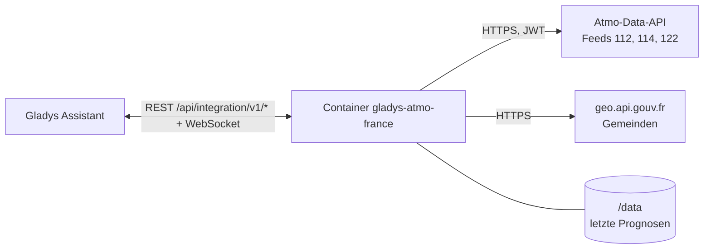
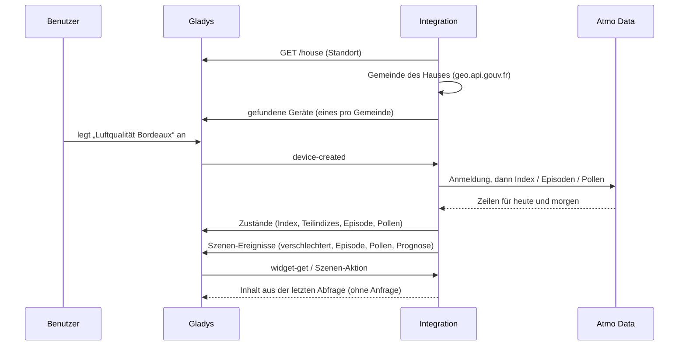
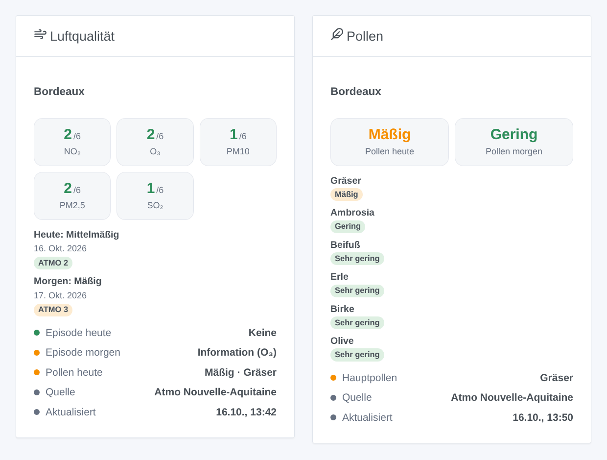

# Gladys Atmo France

[English](README.md) · [Français](README.fr.md) · **Deutsch** · [Español](README.es.md)

[](LICENSE)
[](https://github.com/William-De71/gladys-atmo-france/releases)
[](https://github.com/William-De71/gladys-atmo-france/actions/workflows/release.yml)
[](https://gladysassistant.com)


Externe Integration von [Gladys Assistant](https://gladysassistant.com) für **Atmo France**: der offizielle französische Luftqualitätsindex (ATMO) Ihrer Gemeinde für heute und morgen, die Teilindizes der fünf Schadstoffe, die von der Präfektur angekündigten Schadstoffepisoden und das Pollenallergierisiko. Die Daten stammen von Atmo Data, dem Open-Data-Dienst der Fédération Atmo France und der regionalen Luftgüte-Verbände (AASQA), mit einem kostenlosen Konto.

Benutzerdokumentation: [English](docs/en.md) · [Français](docs/fr.md) · [Deutsch](docs/de.md) · [Español](docs/es.md).

> Community-Integration, weder mit der Fédération Atmo France noch mit den AASQA verbunden oder von ihnen unterstützt.

## Funktionen

- **Ein Gerät pro Gemeinde**, ermittelt aus dem Standort eines Hauses von Gladys oder von Hand eingegeben (Name, Postleitzahl oder INSEE-Code), bis zu drei Gemeinden.
- **ATMO-Index** heute und morgen (1 gut bis 6 extrem schlecht), **Teilindizes** NO₂, O₃, PM10, PM2,5 und SO₂, Luftqualität als Text.
- **Schadstoffepisoden** des Departements heute und morgen (Information und Empfehlungen, Alarm wegen Andauern, Alarm).
- **Pollen** (optional): Risiko heute und morgen, Hauptpollen, Stufe von Ambrosia, Beifuß, Erle, Birke, Gräsern und Olive.
- **4 Szenen-Auslöser**, **1 Szenen-Aktion** und **2 Dashboard-Widgets** (unten).
- Etwa zehn Anfragen pro Tag, außerhalb des Veröffentlichungsfensters von Atmo France; die letzten Daten bleiben über Neustarts erhalten.
- Vier Sprachen überall: Englisch, Französisch, Deutsch, Spanisch.

## Funktionsweise




Die Integration fragt Gladys nach dem Standort des gewählten Hauses, ermittelt dessen Gemeinde (INSEE-Code, Gemeindeverband, Departement) über geo.api.gouv.fr und liest Atmo Data zweimal täglich, gegen 07:30 und 15:30 Uhr Pariser Zeit (für Überseegemeinden auch gegen 20:30 Uhr), mit einigen Minuten Versatz je Installation. Atmo France baut seine Feeds einmal täglich zwischen 13 und 15 Uhr neu auf und bittet, sie in diesem Zeitraum nicht zu lesen. Eine Abfrage besteht aus einer Anmeldung und drei Anfragen (Index, Episoden, Pollen) für alle Gemeinden zugleich.



### Transport

Nur Cloud (`"transports": ["cloud"]`): Der Katalog zeigt das Cloud-Abzeichen. Die Integration kontaktiert `admindata.atmo-france.org` (mit Ihrem Konto) und `geo.api.gouv.fr` (ohne Konto, nur die Koordinaten des gewählten Hauses oder die eingegebene Gemeinde). Sonst verlässt nichts Ihr Netzwerk; eine lokale Alternative gibt es nicht, daher auch keine Schaltfläche „Lokale Verbindung bevorzugen“.

## Geräte und Funktionen

| Funktion                                           | Kategorie / Typ             | Werte                                                   |
| -------------------------------------------------- | --------------------------- | ------------------------------------------------------- |
| ATMO-Index heute, morgen                           | `airquality-sensor` / `aqi` | 1 gut … 6 extrem schlecht                               |
| NO₂, O₃, PM10, PM2,5, SO₂ heute                    | `airquality-sensor` / `aqi` | 1 … 6 (Teilindizes, keine µg/m³)                        |
| Luftqualität heute                                 | `text` / `text`             | „Mittelmäßig“, „Mäßig“ …                                |
| Schadstoffepisode heute, morgen                    | `risk` / `integer`          | 0 keine, 1 Information, 2 Alarm wegen Andauern, 3 Alarm |
| Pollenindex heute, morgen                          | `airquality-sensor` / `aqi` | 1 sehr gering … 6 extrem hoch                           |
| Hauptpollen heute                                  | `text` / `text`             | „Gräser“ …                                              |
| Ambrosia, Beifuß, Erle, Birke, Gräser, Olive heute | `airquality-sensor` / `aqi` | 1 … 6                                                   |

Es wird kein Wert veröffentlicht, wenn Atmo France keinen hat (0, nicht verfügbar) oder ein Sonderereignis meldet (ein Brand): Eine Szene, die „Index ≥ 4“ vergleicht, sieht nie einen erfundenen Wert. Gladys färbt das `aqi`-Abzeichen nach der US-AQI-Skala (0–500): Ein Wert von 1 bis 6 bleibt dort immer grün; die Widgets verwenden die richtigen Farben. Die „morgen“-Funktionen behalten zwischen Mitternacht und der Nachmittagsabfrage die Prognose vom Vortag.

## Szenen-Auslöser, Aktionen und Widgets



**Szenen-Auslöser** (einmal pro Wechsel, nie zweimal für denselben Tag):

- **Luftqualität verschlechtert**: Der ATMO-Index von heute oder morgen erreicht „Mäßig“ oder schlechter oder verschlechtert sich weiter. Filter: Gemeinde, Tag, Stufen.
- **Schadstoffepisode**: Ein Informations- oder Alarmverfahren wird für das Departement angekündigt oder steigt. Filter: Gemeinde, Tag, Verfahren.
- **Pollenrisiko**: Das Pollenrisiko erreicht „Mäßig“ oder mehr oder steigt. Filter: Gemeinde, Tag, Stufen.
- **Prognose für morgen**: einmal täglich am Nachmittag veröffentlicht, mit einer fertigen Zusammenfassung.

**Szenen-Aktion**: **Luftqualität lesen** einer Gemeinde, heute oder morgen: Index, Stufe, Schadstoffe, Episode, Pollen und eine Zusammenfassung für die folgenden Aktionen.

**Widgets**: **Luftqualität** (Teilindizes von heute, eine Karte pro Tag, Episoden, Pollen, Quelle und Aktualisierungszeit) und **Pollen** (heute und morgen, Stufe jeder Art).

Beispiele:

- Wenn **eine Alarm-Episode** für morgen angekündigt wird → `{{triggerEvent.data.summary}}` an die Familie senden und Homeoffice einplanen.
- Wenn **die Prognose für morgen** veröffentlicht wird → sie jeden Nachmittag als Nachricht senden.
- Wenn **die Gräserpollen hoch sind** → die Rollläden im Schlafzimmer schließen und an das Antihistaminikum erinnern.

## Voraussetzungen

- Gladys Assistant **5.3.0** oder neuer (Suchbegriffe und Länder des Katalogs, Hausauswahl in der Konfiguration). Ältere Instanzen können die Integration nicht installieren.
- Ein kostenloses **Atmo-Data-Konto**: beantragen Sie es auf [admindata.atmo-france.org/inscription-api](https://admindata.atmo-france.org/inscription-api); Atmo France bestätigt es per E-Mail (einige Tage), danach wählen Sie ein Passwort.
- Ein Haus von Gladys mit Standort oder der Name einer französischen Gemeinde (Übersee eingeschlossen).

## Installation

- **Aus dem Store** von Gladys (Integrationen → Externe Integrationen), mit einem Klick, sobald indexiert.
- **Über die Repository-URL**: `https://github.com/William-De71/gladys-atmo-france`.
- **Entwicklermodus**: Image lokal bauen (`docker build -t gladys-atmo-france .`) und aus Gladys installieren.

## Konfiguration

| Feld                         | Beschreibung                                                                         |
| ---------------------------- | ------------------------------------------------------------------------------------ |
| Benutzername, Passwort       | Ihr Atmo-Data-Konto (das Passwort ist ein Geheimnis: nie protokolliert).             |
| Haus (1 bis 3)               | Ein Haus von Gladys: sein Standort ergibt die Gemeinde.                              |
| Oder eine Gemeinde (1 bis 3) | „Mâcon“, „71000“, „Saint-Denis 93200“ oder der INSEE-Code; hat Vorrang vor dem Haus. |
| Pollen                       | Auch das Pollenrisiko lesen (standardmäßig an).                                      |
| Sprache der Texte            | Gerätenamen, Luftqualität als Text, Szenen-Zusammenfassungen.                        |

Schaltflächen: **Jetzt lesen** (höchstens alle 10 Minuten) und **Diagnose** (schreibt den Zustand der Integration in den Tab Protokolle, ohne das Konto).

## Verwendung

1. Konto eintragen und ein Haus wählen (oder eine Gemeinde eingeben), dann speichern.
2. Im Tab **Entdecken** das Gerät „Luftqualität …“ jeder Gemeinde anlegen.
3. Die Widgets **Luftqualität** und **Pollen** zu einem Dashboard hinzufügen und Szenen mit den obigen Auslösern bauen.

## Entwicklung

```bash
npm install
npm test                       # node --test, nie ins Netzwerk
npm run lint && npm run format:check
npx github:GladysAssistant/integration-store . --skip-image-check
scripts/build-cover.sh         # cover.jpg aus docs/assets/cover.svg
docs/illustrations/render.sh   # docs/assets/widgets.<lang>.png
node .github/scripts/release.mjs next
```

Lokal liest das SDK `GLADYS_HOST_API_URL`, `GLADYS_INTEGRATION_TOKEN` und `GLADYS_INTEGRATION_SELECTOR`; `DEBUG=gladys-integration-sdk` zeigt die SDK-Protokolle und prüft jeden Widget-Inhalt. Die Regeln des Projekts stehen in [CLAUDE.md](CLAUDE.md).

## Release-Prozess


Jeder Merge auf `main` startet die CI und berechnet dann die Version aus den [Conventional Commits](https://www.conventionalcommits.org/) seit dem letzten Tag: `feat` → Minor, `fix` / `perf` → Patch, `!` oder `BREAKING CHANGE` → Major (Minor unter 1.0.0); `docs`, `chore`, `ci`, `test`, `style`, `refactor`, `build` allein veröffentlichen nichts. Der Changelog-Abschnitt wird erzeugt, der Tag gepusht, das Multi-Architektur-Image gebaut, dann erhält `main` den Release-Commit, das GitHub Release wird erstellt und ein letzter Job prüft das öffentliche Image, den Store-Validator und das Topic.

- Der Titel des Pull Requests wird zum Squash-Commit und dann zur Changelog-Zeile: auf Englisch, für den Benutzer (`pr-title.yml` prüft ihn). `CHANGELOG.md` nie von Hand bearbeiten.
- 1.0.0 ist eine Entscheidung: Actions → Release → Run workflow mit `release-as: 1.0.0`. `dry-run` zeigt Version und Notizen, ohne zu veröffentlichen.
- **Geschützter Branch**: Das Release pusht seinen Commit mit `GITHUB_TOKEN` auf `main`. Mit einem Ruleset auf `main` GitHub Actions in dessen Bypass-Liste aufnehmen (oder über eine GitHub App pushen), sonst schlägt der Veröffentlichungsjob mit Anweisungen fehl.
- Nach dem ersten Release das Paket auf `ghcr.io` öffentlich machen (Package settings → Change visibility), sonst kann Gladys es nicht laden.

## Fehlerbehebung

Siehe [docs/de.md](docs/de.md#fehlerbehebung). Melden Sie Probleme mit den Versionen von Gladys und der Integration, der Gemeinde und den Zeilen der Schaltfläche **Diagnose**.

## Mitwirken

Issues und Pull Requests sind willkommen. Vor einem Pull Request `npm run format:check && npm run lint && npm test` ausführen und keine externe ID und keinen gespeicherten Schlüssel ändern (siehe [CLAUDE.md](CLAUDE.md)).

## Sicherheit

Siehe [SECURITY.md](SECURITY.md): Schwachstellen bitte vertraulich melden. Das Passwort ist ein `secret`-Feld, nie protokolliert und nie in einer URL; die Integration meldet sich einmal pro Abfrage an, und ein abgelehntes Passwort wird erst beim nächsten Abfragezeitpunkt erneut versucht.

## Kommende Screenshots

Die Bilder oben sind Illustrationen, keine Screenshots. Echte Screenshots kommen nach `docs/assets/screenshots/` (PNG, 1280 × 800): `configuration.png`, `discovery.png`, `device.png`, `scene.png`.

## Lizenz

[Apache-Lizenz 2.0](LICENSE) — siehe auch [NOTICE](NOTICE). Die Daten werden von den AASQA erzeugt und von der Fédération Atmo France unter der Open Database License (ODbL) zusammengeführt: Die Widgets zeigen die Quelle jeder Abfrage. Dank an die Dokumentation und das SDK von Gladys, an die Home-Assistant-Integration atmofrance und an das Projekt Recosante.
