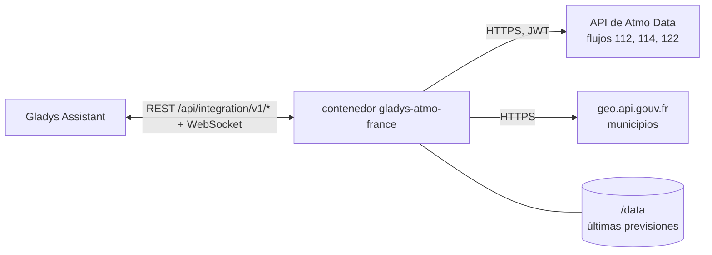
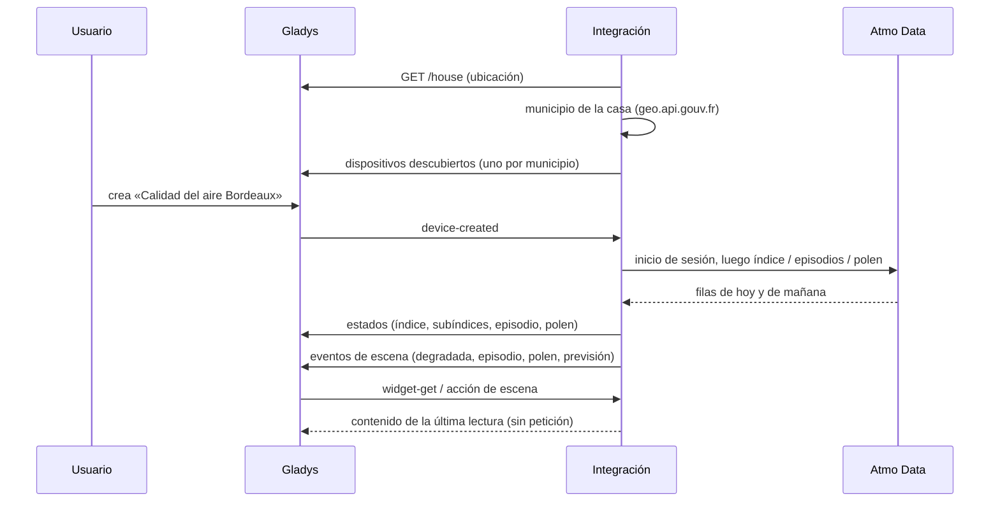
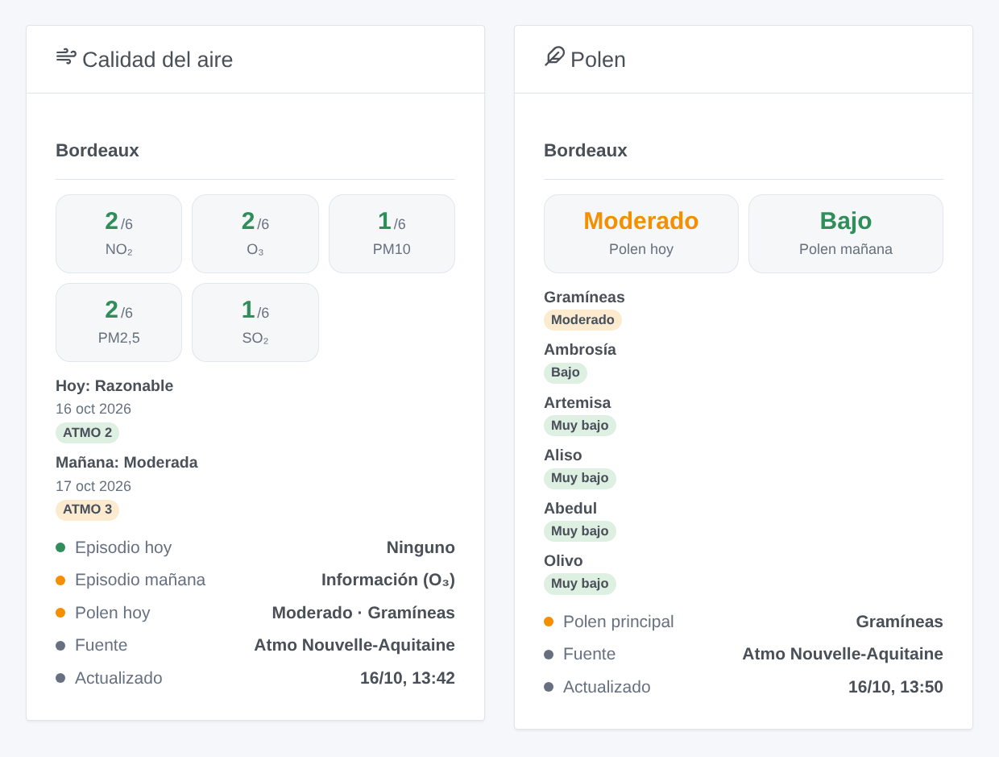

# Gladys Atmo France

[English](README.md) · [Français](README.fr.md) · [Deutsch](README.de.md) · **Español**

[](LICENSE)
[](https://github.com/William-De71/gladys-atmo-france/releases)
[](https://github.com/William-De71/gladys-atmo-france/actions/workflows/release.yml)
[](https://gladysassistant.com)


Integración externa de [Gladys Assistant](https://gladysassistant.com) para **Atmo France**: el índice oficial francés de calidad del aire (ATMO) de su municipio hoy y mañana, los subíndices de los cinco contaminantes, los episodios de contaminación anunciados por la prefectura y el riesgo de alergia al polen. Los datos proceden de Atmo Data, el servicio de datos abiertos de la Fédération Atmo France y de las asociaciones regionales de vigilancia de la calidad del aire (AASQA), con una cuenta gratuita.

Documentación de usuario: [English](docs/en.md) · [Français](docs/fr.md) · [Deutsch](docs/de.md) · [Español](docs/es.md).

> Integración comunitaria, sin afiliación ni respaldo de la Fédération Atmo France ni de las AASQA.

## Funciones

- **Un dispositivo por municipio**, obtenido de la ubicación de una casa de Gladys o escrito a mano (nombre, código postal o código INSEE), hasta tres municipios.
- **Índice ATMO** hoy y mañana (1 buena a 6 extremadamente mala), **subíndices** NO₂, O₃, PM10, PM2,5 y SO₂, calidad del aire en texto.
- **Episodios de contaminación** del departamento hoy y mañana (información y recomendaciones, alerta por persistencia, alerta).
- **Polen** (opcional): riesgo hoy y mañana, polen principal, nivel de ambrosía, artemisa, aliso, abedul, gramíneas y olivo.
- **4 disparadores de escena**, **1 acción de escena** y **2 widgets** de panel (abajo).
- Una decena de peticiones al día, fuera de la franja de publicación de Atmo France; los últimos datos se conservan entre reinicios.
- Cuatro idiomas en todas partes: inglés, francés, alemán, español.

## Funcionamiento




La integración pide a Gladys la ubicación de la casa elegida, encuentra su municipio (código INSEE, mancomunidad, departamento) en geo.api.gouv.fr y lee Atmo Data dos veces al día, hacia las 07:30 y las 15:30 hora de París (también hacia las 20:30 para los municipios de ultramar), con unos minutos de desfase propios de cada instalación. Atmo France reconstruye sus flujos una vez al día entre las 13:00 y las 15:00 y pide no leerlos en esa franja. Una lectura es un inicio de sesión y tres peticiones (índice, episodios, polen) para todos los municipios a la vez.



### Transporte

Solo nube (`"transports": ["cloud"]`): el catálogo muestra la insignia de nube. La integración contacta con `admindata.atmo-france.org` (con su cuenta) y `geo.api.gouv.fr` (sin cuenta, solo las coordenadas de la casa elegida o el municipio escrito). Nada más sale de su red; no existe alternativa local, así que no hay botón «Preferir la conexión local».

## Dispositivos y funciones

| Función                                                 | Categoría / tipo            | Valores                                                       |
| ------------------------------------------------------- | --------------------------- | ------------------------------------------------------------- |
| Índice ATMO hoy, mañana                                 | `airquality-sensor` / `aqi` | 1 buena … 6 extremadamente mala                               |
| NO₂, O₃, PM10, PM2,5, SO₂ hoy                           | `airquality-sensor` / `aqi` | 1 … 6 (subíndices, no µg/m³)                                  |
| Calidad del aire hoy                                    | `text` / `text`             | «Razonable», «Moderada»…                                      |
| Episodio de contaminación hoy, mañana                   | `risk` / `integer`          | 0 ninguno, 1 información, 2 alerta por persistencia, 3 alerta |
| Índice de polen hoy, mañana                             | `airquality-sensor` / `aqi` | 1 muy bajo … 6 extremadamente alto                            |
| Polen principal hoy                                     | `text` / `text`             | «Gramíneas»…                                                  |
| Ambrosía, artemisa, aliso, abedul, gramíneas, olivo hoy | `airquality-sensor` / `aqi` | 1 … 6                                                         |

No se publica ningún valor cuando Atmo France no lo tiene (0, no disponible) o anuncia un evento especial (un incendio): una escena que compara «índice ≥ 4» nunca ve un valor inventado. Gladys colorea la insignia `aqi` según la escala AQI estadounidense (0–500): un valor de 1 a 6 siempre aparece en verde; los widgets usan los colores correctos. Las funciones de «mañana» conservan la previsión del día anterior entre la medianoche y la lectura de la tarde.

## Disparadores, acciones de escena y widgets



**Disparadores de escena** (una vez por cambio, nunca dos veces para el mismo día):

- **Calidad del aire degradada**: el índice ATMO de hoy o de mañana llega a «Moderada» o peor, o empeora de nuevo. Filtros: municipio, día, niveles.
- **Episodio de contaminación**: se anuncia un procedimiento de información o alerta para el departamento, o sube de nivel. Filtros: municipio, día, procedimiento.
- **Riesgo de polen**: el riesgo de polen llega a «Moderado» o más, o sube. Filtros: municipio, día, niveles.
- **Previsión de mañana**: publicada una vez al día, por la tarde, con un resumen listo para usar.

**Acción de escena**: **leer la calidad del aire** de un municipio, hoy o mañana: índice, nivel, contaminantes, episodio, polen y un resumen para las acciones siguientes.

**Widgets**: **Calidad del aire** (subíndices de hoy, una tarjeta por día, episodios, polen, fuente y hora de actualización) y **Polen** (hoy y mañana, nivel de cada taxón).

Ejemplos:

- Cuando se anuncia **un episodio de alerta** para mañana → enviar `{{triggerEvent.data.summary}}` a la familia y prever teletrabajo.
- Cuando se publica **la previsión de mañana** → enviarla como mensaje cada tarde.
- Cuando **las gramíneas están altas** → cerrar las persianas del dormitorio y recordar tomar el antihistamínico.

## Requisitos

- Gladys Assistant **5.3.0** o posterior (palabras clave y países del catálogo, selector de casa en la configuración). Las instancias más antiguas no pueden instalar la integración.
- Una **cuenta de Atmo Data** gratuita: solicítela en [admindata.atmo-france.org/inscription-api](https://admindata.atmo-france.org/inscription-api); Atmo France la valida por correo (unos días) y después elige una contraseña.
- Una casa de Gladys con su ubicación, o el nombre de un municipio francés (ultramar incluido).

## Instalación

- **Desde la tienda** de Gladys (Integraciones → Integraciones externas), con un clic, una vez indexada.
- **Desde la URL del repositorio**: `https://github.com/William-De71/gladys-atmo-france`.
- **Modo desarrollador**: construya la imagen en local (`docker build -t gladys-atmo-france .`) e instálela desde Gladys.

## Configuración

| Campo                  | Descripción                                                                       |
| ---------------------- | --------------------------------------------------------------------------------- |
| Usuario, Contraseña    | Su cuenta de Atmo Data (la contraseña es un secreto: nunca se registra).          |
| Casa (1 a 3)           | Una casa de Gladys: su ubicación da el municipio.                                 |
| O un municipio (1 a 3) | «Mâcon», «71000», «Saint-Denis 93200» o el código INSEE; prevalece sobre la casa. |
| Polen                  | Leer también el riesgo de polen (activado por defecto).                           |
| Idioma de los textos   | Nombres de los dispositivos, calidad del aire en texto, resúmenes de escenas.     |

Botones: **Leer ahora** (como mucho cada 10 minutos) y **Diagnóstico** (escribe el estado de la integración en la pestaña Registros, sin la cuenta).

## Uso

1. Rellene la cuenta y elija una casa (o escriba un municipio), luego guarde.
2. En la pestaña **Descubrir**, cree el dispositivo «Calidad del aire …» de cada municipio.
3. Añada los widgets **Calidad del aire** y **Polen** a un panel y cree escenas con los disparadores anteriores.

## Desarrollo

```bash
npm install
npm test                       # node --test, nunca toca la red
npm run lint && npm run format:check
npx github:GladysAssistant/integration-store . --skip-image-check
scripts/build-cover.sh         # cover.jpg desde docs/assets/cover.svg
docs/illustrations/render.sh   # docs/assets/widgets.<lang>.png
node .github/scripts/release.mjs next
```

En local, el SDK lee `GLADYS_HOST_API_URL`, `GLADYS_INTEGRATION_TOKEN` y `GLADYS_INTEGRATION_SELECTOR`; `DEBUG=gladys-integration-sdk` muestra los registros del SDK y comprueba cada contenido de widget. Las reglas del proyecto están en [CLAUDE.md](CLAUDE.md).

## Proceso de publicación


Cada fusión en `main` lanza la CI y calcula la versión a partir de los [Conventional Commits](https://www.conventionalcommits.org/) desde la última etiqueta: `feat` → menor, `fix` / `perf` → parche, `!` o `BREAKING CHANGE` → mayor (menor por debajo de 1.0.0); `docs`, `chore`, `ci`, `test`, `style`, `refactor`, `build` solos no publican nada. Se genera la sección del changelog, se empuja la etiqueta, se construye la imagen multiarquitectura, después `main` recibe el commit de publicación, se crea la GitHub Release y un último job comprueba la imagen pública, el validador de la tienda y el topic.

- El título de la pull request se convierte en el commit squash y luego en la línea del changelog: escríbalo en inglés, para el usuario (`pr-title.yml` lo comprueba). No edite nunca `CHANGELOG.md` a mano.
- La 1.0.0 es una decisión: Actions → Release → Run workflow con `release-as: 1.0.0`. `dry-run` muestra la versión y las notas sin publicar.
- **Rama protegida**: la publicación empuja su commit a `main` con `GITHUB_TOKEN`. Con un ruleset en `main`, añada GitHub Actions a su lista de omisión (o empuje mediante una GitHub App); si no, el job de publicación falla con instrucciones.
- Tras la primera publicación, haga público el paquete de `ghcr.io` (Package settings → Change visibility), o Gladys no podrá descargarlo.

## Solución de problemas

Vea [docs/es.md](docs/es.md#solución-de-problemas). Informe de los problemas con las versiones de Gladys y de la integración, el municipio y las líneas del botón **Diagnóstico**.

## Contribuir

Las issues y pull requests son bienvenidas. Ejecute `npm run format:check && npm run lint && npm test` antes de abrir una pull request y no cambie ningún identificador externo ni clave almacenada (vea [CLAUDE.md](CLAUDE.md)).

## Seguridad

Vea [SECURITY.md](SECURITY.md): informe de las vulnerabilidades en privado. La contraseña es un campo `secret`, nunca registrado ni puesto en una URL; la integración inicia sesión una vez por lectura, y una contraseña rechazada no se vuelve a probar antes del siguiente horario de lectura.

## Capturas pendientes

Las imágenes anteriores son ilustraciones, no capturas de pantalla. Las capturas reales irán en `docs/assets/screenshots/` (PNG, 1280 × 800): `configuration.png`, `discovery.png`, `device.png`, `scene.png`.

## Licencia

[Licencia Apache 2.0](LICENSE) — vea también [NOTICE](NOTICE). Los datos los producen las AASQA y los agrega la Fédération Atmo France bajo la Open Database License (ODbL): los widgets muestran la fuente de cada lectura. Gracias a la documentación y al SDK de Gladys, a la integración atmofrance de Home Assistant y al proyecto Recosante.
