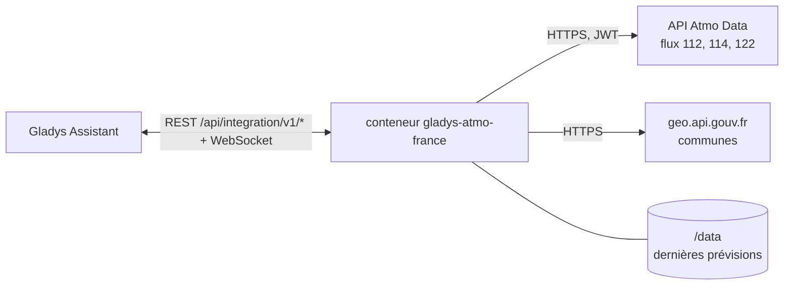
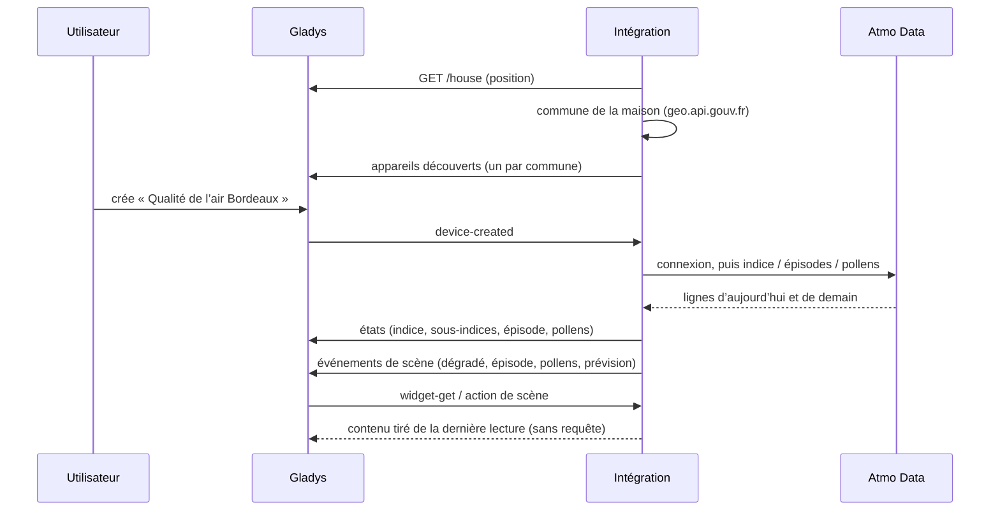
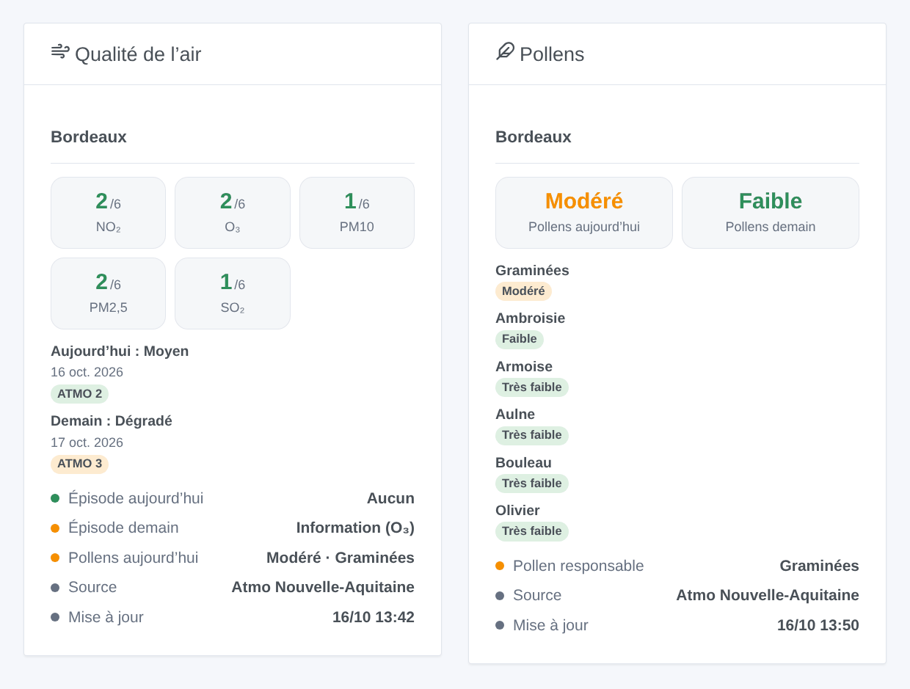

# Gladys Atmo France

[English](README.md) · **Français** · [Deutsch](README.de.md) · [Español](README.es.md)

[](LICENSE)
[](https://github.com/William-De71/gladys-atmo-france/releases)
[](https://github.com/William-De71/gladys-atmo-france/actions/workflows/release.yml)
[](https://gladysassistant.com)


Intégration externe de [Gladys Assistant](https://gladysassistant.com) pour **Atmo France** : l’indice officiel de qualité de l’air (ATMO) de votre commune aujourd’hui et demain, les sous-indices des cinq polluants, les épisodes de pollution annoncés par la préfecture et le risque d’allergie aux pollens. Les données viennent d’Atmo Data, le service de données ouvertes de la Fédération Atmo France et des associations régionales de surveillance de la qualité de l’air (AASQA), avec un compte gratuit.

Documentation utilisateur : [English](docs/en.md) · [Français](docs/fr.md) · [Deutsch](docs/de.md) · [Español](docs/es.md).

> Intégration communautaire, ni affiliée ni approuvée par la Fédération Atmo France ou les AASQA.

## Fonctionnalités

- **Un appareil par commune**, trouvée depuis la position d’une maison de Gladys ou saisie à la main (nom, code postal ou code INSEE), jusqu’à trois communes.
- **Indice ATMO** aujourd’hui et demain (1 bon à 6 extrêmement mauvais), **sous-indices** NO₂, O₃, PM10, PM2,5 et SO₂, qualité de l’air en texte.
- **Épisodes de pollution** du département aujourd’hui et demain (information et recommandation, alerte sur persistance, alerte).
- **Pollens** (facultatif) : risque aujourd’hui et demain, pollen responsable, niveau de l’ambroisie, de l’armoise, de l’aulne, du bouleau, des graminées et de l’olivier.
- **4 déclencheurs de scène**, **1 action de scène** et **2 widgets** de tableau de bord (ci-dessous).
- Une dizaine de requêtes par jour, hors de la plage de publication d’Atmo France ; les dernières données sont gardées d’un redémarrage à l’autre.
- Quatre langues partout : anglais, français, allemand, espagnol.

## Fonctionnement




L’intégration demande à Gladys la position de la maison choisie, trouve sa commune (code INSEE, intercommunalité, département) sur geo.api.gouv.fr, puis lit Atmo Data deux fois par jour, vers 7 h 30 et 15 h 30 heure de Paris (aussi vers 20 h 30 pour les communes d’outre-mer), avec quelques minutes de décalage propres à chaque installation. Atmo France reconstruit ses flux une fois par jour entre 13 h et 15 h et demande de ne pas les lire pendant cette plage. Une lecture, c’est une connexion et trois requêtes (indice, épisodes, pollens) pour toutes les communes à la fois.



### Transport

Cloud uniquement (`"transports": ["cloud"]`) : le catalogue affiche le badge cloud. L’intégration contacte `admindata.atmo-france.org` (avec votre compte) et `geo.api.gouv.fr` (sans compte, seulement les coordonnées de la maison choisie ou la commune saisie). Rien d’autre ne sort de votre réseau ; il n’existe pas d’alternative locale, donc pas de bouton « Préférer la connexion locale ».

## Appareils et fonctionnalités

| Fonctionnalité                                                     | Catégorie / type            | Valeurs                                                    |
| ------------------------------------------------------------------ | --------------------------- | ---------------------------------------------------------- |
| Indice ATMO aujourd’hui, demain                                    | `airquality-sensor` / `aqi` | 1 bon … 6 extrêmement mauvais                              |
| NO₂, O₃, PM10, PM2,5, SO₂ aujourd’hui                              | `airquality-sensor` / `aqi` | 1 … 6 (sous-indices, pas des µg/m³)                        |
| Qualité de l’air aujourd’hui                                       | `text` / `text`             | « Moyen », « Dégradé »…                                    |
| Épisode de pollution aujourd’hui, demain                           | `risk` / `integer`          | 0 aucun, 1 information, 2 alerte sur persistance, 3 alerte |
| Indice pollens aujourd’hui, demain                                 | `airquality-sensor` / `aqi` | 1 très faible … 6 extrêmement élevé                        |
| Pollen responsable aujourd’hui                                     | `text` / `text`             | « Graminées »…                                             |
| Ambroisie, armoise, aulne, bouleau, graminées, olivier aujourd’hui | `airquality-sensor` / `aqi` | 1 … 6                                                      |

Aucune valeur n’est publiée quand Atmo France n’en a pas (0, indisponible) ou annonce un événement (un incendie) : une scène qui compare « indice ≥ 4 » ne voit jamais de valeur inventée. Gladys colore le badge `aqi` sur l’échelle AQI américaine (0–500) : une valeur de 1 à 6 y reste toujours verte ; les widgets, eux, utilisent les bonnes couleurs. Les fonctionnalités « demain » gardent la prévision de la veille entre minuit et la lecture de l’après-midi.

## Déclencheurs, actions de scène et widgets



**Déclencheurs de scène** (une fois par changement, jamais deux fois pour le même jour) :

- **Qualité de l’air dégradée** : l’indice ATMO d’aujourd’hui ou de demain passe à « Dégradé » ou pire, ou s’aggrave encore. Filtres : commune, jour, niveaux.
- **Épisode de pollution** : une procédure d’information ou d’alerte est annoncée pour le département, ou monte d’un niveau. Filtres : commune, jour, procédure.
- **Risque pollens** : le risque pollens atteint « Modéré » ou plus, ou augmente. Filtres : commune, jour, niveaux.
- **Prévision de demain** : publiée une fois par jour, l’après-midi, avec un résumé prêt à l’emploi.

**Action de scène** : **lire la qualité de l’air** d’une commune, aujourd’hui ou demain : indice, niveau, polluants, épisode, pollens et un résumé pour les actions suivantes.

**Widgets** : **Qualité de l’air** (sous-indices du jour, une carte par jour, épisodes, pollens, source et heure de mise à jour) et **Pollens** (aujourd’hui et demain, niveau de chaque taxon).

Exemples :

- Quand **un épisode d’alerte** est annoncé pour demain → envoyer `{{triggerEvent.data.summary}}` à la famille et prévoir du télétravail.
- Quand **la prévision de demain** est publiée → l’envoyer en message chaque après-midi.
- Quand **les graminées sont élevées** → fermer les volets de la chambre et rappeler de prendre l’antihistaminique.

## Prérequis

- Gladys Assistant **5.3.0** ou plus récent (mots-clés et pays du catalogue, sélecteur de maison dans la configuration). Les instances plus anciennes ne peuvent pas installer l’intégration.
- Un **compte Atmo Data** gratuit : demandez-le sur [admindata.atmo-france.org/inscription-api](https://admindata.atmo-france.org/inscription-api) ; Atmo France le valide par e-mail (quelques jours), puis vous choisissez un mot de passe.
- Une maison de Gladys avec sa position, ou le nom d’une commune française (outre-mer compris).

## Installation

- **Depuis le store** de Gladys (Intégrations → Intégrations externes), en un clic, une fois indexée.
- **Depuis l’URL du dépôt** : `https://github.com/William-De71/gladys-atmo-france`.
- **Mode développeur** : construisez l’image en local (`docker build -t gladys-atmo-france .`) et installez-la depuis Gladys.

## Configuration

| Champ                     | Description                                                                               |
| ------------------------- | ----------------------------------------------------------------------------------------- |
| Identifiant, Mot de passe | Votre compte Atmo Data (le mot de passe est un secret : jamais journalisé).               |
| Maison (1 à 3)            | Une maison de Gladys : sa position donne la commune.                                      |
| Ou une commune (1 à 3)    | « Mâcon », « 71000 », « Saint-Denis 93200 » ou le code INSEE ; prioritaire sur la maison. |
| Pollens                   | Lire aussi le risque pollens (activé par défaut).                                         |
| Langue des textes         | Noms des appareils, qualité de l’air en texte, résumés des scènes.                        |

Boutons : **Lire maintenant** (au plus toutes les 10 minutes) et **Diagnostic** (écrit l’état de l’intégration dans l’onglet Journaux, sans le compte).

## Utilisation

1. Renseignez le compte et choisissez une maison (ou saisissez une commune), puis enregistrez.
2. Dans l’onglet **Découverte**, créez l’appareil « Qualité de l’air … » de chaque commune.
3. Ajoutez les widgets **Qualité de l’air** et **Pollens** à un tableau de bord, et construisez des scènes avec les déclencheurs ci-dessus.

## Développement

```bash
npm install
npm test                       # node --test, ne touche jamais le réseau
npm run lint && npm run format:check
npx github:GladysAssistant/integration-store . --skip-image-check
scripts/build-cover.sh         # cover.jpg depuis docs/assets/cover.svg
docs/illustrations/render.sh   # docs/assets/widgets.<lang>.png
node .github/scripts/release.mjs next
```

En local, le SDK lit `GLADYS_HOST_API_URL`, `GLADYS_INTEGRATION_TOKEN` et `GLADYS_INTEGRATION_SELECTOR` ; `DEBUG=gladys-integration-sdk` affiche les journaux du SDK et vérifie chaque contenu de widget. Les règles du projet sont dans [CLAUDE.md](CLAUDE.md).

## Processus de release


Chaque fusion sur `main` lance la CI, puis calcule la version à partir des [Conventional Commits](https://www.conventionalcommits.org/) depuis le dernier tag : `feat` → mineure, `fix` / `perf` → correctif, `!` ou `BREAKING CHANGE` → majeure (mineure sous 1.0.0) ; `docs`, `chore`, `ci`, `test`, `style`, `refactor`, `build` seuls ne publient rien. La section du changelog est générée, le tag poussé, l’image multi-architecture construite, puis `main` reçoit le commit de release, la GitHub Release est créée et un dernier job vérifie l’image publique, le validateur du store et le topic.

- Le titre de la pull request devient le commit squash, puis la ligne du changelog : rédigez-le en anglais, pour l’utilisateur (`pr-title.yml` le vérifie). Ne modifiez jamais `CHANGELOG.md` à la main.
- La 1.0.0 est une décision : Actions → Release → Run workflow avec `release-as: 1.0.0`. `dry-run` affiche la version et les notes sans rien publier.
- **Branche protégée** : la release pousse son commit sur `main` avec `GITHUB_TOKEN`. Avec un ruleset sur `main`, ajoutez GitHub Actions à sa liste de contournement (ou poussez via une GitHub App), sinon le job de publication échoue avec des instructions.
- Après la première release, rendez public le package `ghcr.io` (Package settings → Change visibility), sinon Gladys ne peut pas le télécharger.

## Dépannage

Voir [docs/fr.md](docs/fr.md#dépannage). Signalez un problème avec les versions de Gladys et de l’intégration, la commune et les lignes du bouton **Diagnostic**.

## Contribuer

Les issues et pull requests sont les bienvenues. Lancez `npm run format:check && npm run lint && npm test` avant d’ouvrir une pull request, et ne changez aucun identifiant externe ni aucune clé stockée (voir [CLAUDE.md](CLAUDE.md)).

## Sécurité

Voir [SECURITY.md](SECURITY.md) : signalez les vulnérabilités en privé. Le mot de passe est un champ `secret`, jamais journalisé ni mis dans une URL ; l’intégration se connecte une fois par lecture, et un mot de passe refusé n’est pas réessayé avant le créneau de lecture suivant.

## Captures à venir

Les images ci-dessus sont des illustrations, pas des captures d’écran. Les vraies captures iront dans `docs/assets/screenshots/` (PNG, 1280 × 800) : `configuration.png`, `discovery.png`, `device.png`, `scene.png`.

## Licence

[Licence Apache 2.0](LICENSE) — voir aussi [NOTICE](NOTICE). Les données sont produites par les AASQA et agrégées par la Fédération Atmo France sous licence ODbL : les widgets affichent la source de chaque lecture. Merci à la documentation et au SDK de Gladys, à l’intégration atmofrance de Home Assistant et au projet Recosante.
