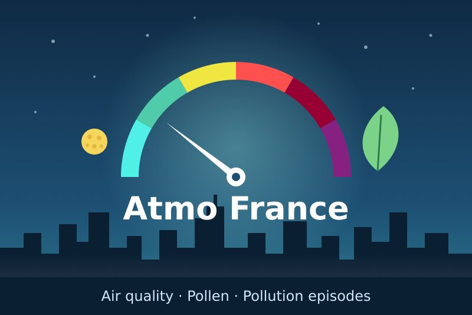
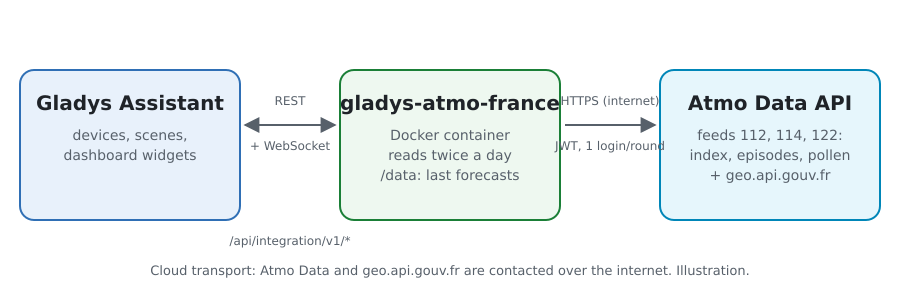
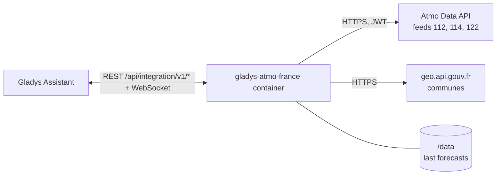
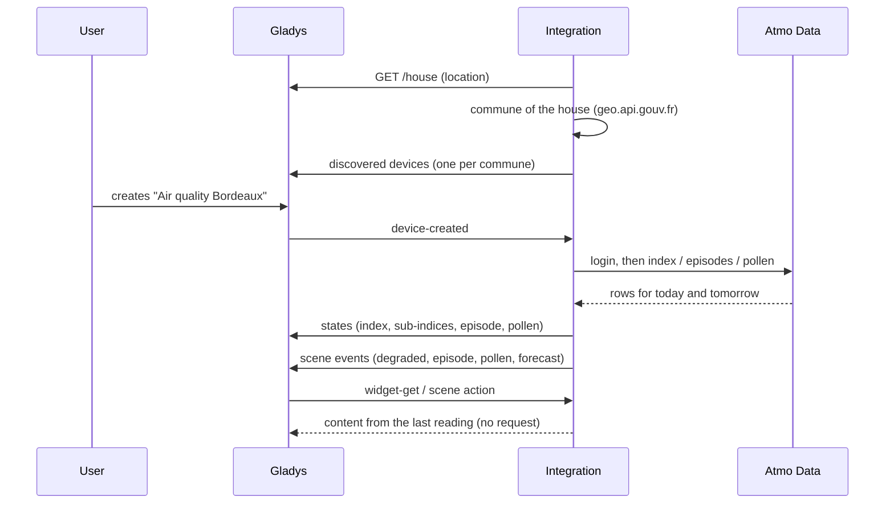
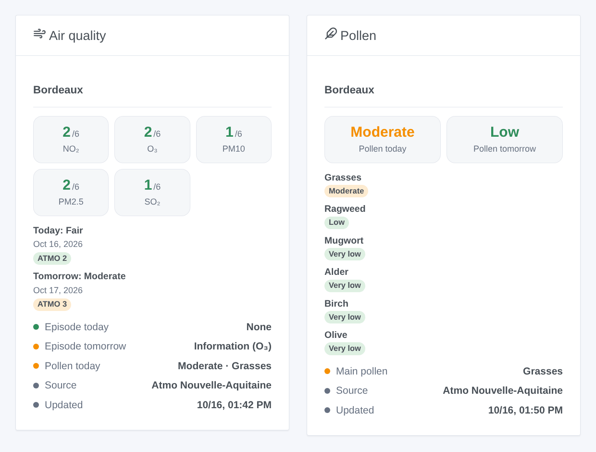

# Gladys Atmo France

**English** · [Français](README.fr.md) · [Deutsch](README.de.md) · [Español](README.es.md)

[](LICENSE)
[](https://github.com/William-De71/gladys-atmo-france/releases)
[](https://github.com/William-De71/gladys-atmo-france/actions/workflows/release.yml)
[](https://gladysassistant.com)



[Gladys Assistant](https://gladysassistant.com) external integration for **Atmo France**: the official French air quality index (ATMO) of your commune today and tomorrow, the sub-indices of the five pollutants, the pollution episodes announced by the prefecture and the pollen allergy risk. The data come from Atmo Data, the open data service of the Fédération Atmo France and of the regional air quality agencies (AASQA), with a free account.

User documentation: [English](docs/en.md) · [Français](docs/fr.md) · [Deutsch](docs/de.md) · [Español](docs/es.md).

> Community integration, not affiliated with nor endorsed by the Fédération Atmo France or the AASQA.

## Features

- **One device per commune**, found from the location of a house of Gladys or typed by hand (name, postal code or INSEE code), up to three communes.
- **ATMO index** today and tomorrow (1 good to 6 extremely poor), **sub-indices** of NO₂, O₃, PM10, PM2.5 and SO₂, air quality as text.
- **Pollution episodes** of the department today and tomorrow (information and advice, alert on persistence, alert).
- **Pollen** (optional): risk today and tomorrow, main pollen, level of ragweed, mugwort, alder, birch, grasses and olive.
- **4 scene triggers**, **1 scene action** and **2 dashboard widgets** (below).
- About ten requests a day, outside the publication window of Atmo France; the last data are kept across restarts.
- Four languages everywhere: English, French, German, Spanish.

## How it works





The integration asks Gladys for the location of the chosen house, finds its commune (INSEE code, intercommunality, department) on geo.api.gouv.fr, then reads Atmo Data twice a day, at about 07:30 and 15:30 Paris time (20:30 too for overseas communes), with a few minutes of offset per installation. Atmo France rebuilds its feeds once a day between 13:00 and 15:00 and asks not to read them during that window. A reading is one login and three requests (index, episodes, pollen) for every commune at once.



### Transport

Cloud only (`"transports": ["cloud"]`): the catalog shows the cloud badge. The integration contacts `admindata.atmo-france.org` (with your account) and `geo.api.gouv.fr` (no account, only the coordinates of the chosen house or the commune you typed). Nothing else leaves your network; there is no local alternative, so there is no "prefer the local connection" button.

## Devices and features

| Feature                                              | Category / type             | Values                                              |
| ---------------------------------------------------- | --------------------------- | --------------------------------------------------- |
| ATMO index today, tomorrow                           | `airquality-sensor` / `aqi` | 1 good … 6 extremely poor                           |
| NO₂, O₃, PM10, PM2.5, SO₂ today                      | `airquality-sensor` / `aqi` | 1 … 6 (sub-indices, not µg/m³)                      |
| Air quality today                                    | `text` / `text`             | "Fair", "Moderate"…                                 |
| Pollution episode today, tomorrow                    | `risk` / `integer`          | 0 none, 1 information, 2 persistence alert, 3 alert |
| Pollen index today, tomorrow                         | `airquality-sensor` / `aqi` | 1 very low … 6 extremely high                       |
| Main pollen today                                    | `text` / `text`             | "Grasses"…                                          |
| Ragweed, mugwort, alder, birch, grasses, olive today | `airquality-sensor` / `aqi` | 1 … 6                                               |

No value is published when Atmo France has none (0, unavailable) or announces a special event (a fire): a scene comparing "index ≥ 4" never sees a made-up value. Gladys colors the `aqi` badge on the US AQI scale (0–500): a value of 1 to 6 always shows green there; the widgets use the right colors. The tomorrow features keep yesterday's forecast between midnight and the afternoon reading.

## Scene triggers, actions and widgets



**Scene triggers** (once per transition, never twice for the same day):

- **Air quality degraded**: the ATMO index of today or tomorrow reaches "Moderate" or worse, or worsens again. Filters: commune, day, levels.
- **Pollution episode**: an information or alert procedure is announced for the department, or rises. Filters: commune, day, procedure.
- **Pollen risk**: the pollen risk reaches "Moderate" or more, or rises. Filters: commune, day, levels.
- **Tomorrow's forecast**: published once a day, in the afternoon, with a ready-made summary.

**Scene action**: **read the air quality** of a commune, today or tomorrow: index, level, pollutants, episode, pollen and a summary for the following actions.

**Widgets**: **Air quality** (sub-indices of today, a card per day, episodes, pollen, source and update time) and **Pollen** (today and tomorrow, level of each taxon).

Examples:

- When **an alert episode** is announced for tomorrow → send `{{triggerEvent.data.summary}}` to the family and plan to work from home.
- When **tomorrow's forecast** is published → send it as a message every afternoon.
- When **the grasses pollen is high** → close the bedroom shutters and remind to take the antihistamine.

## Requirements

- Gladys Assistant **5.2.0** or later (house selector in the configuration). Older instances cannot install the integration.
- A free **Atmo Data account**: request it on [admindata.atmo-france.org/inscription-api](https://admindata.atmo-france.org/inscription-api); Atmo France validates it by e-mail (a few days), then you choose a password.
- A house of Gladys with its location, or the name of a French commune (overseas included).

## Installation

- **From the store** of Gladys (Integrations → External integrations), in one click, once indexed.
- **From the repository URL**: `https://github.com/William-De71/gladys-atmo-france`.
- **Developer mode**: build the image locally (`docker build -t gladys-atmo-france .`) and install it from Gladys.

## Configuration

| Field                 | Description                                                                   |
| --------------------- | ----------------------------------------------------------------------------- |
| User name, Password   | Your Atmo Data account (the password is a secret: never logged).              |
| House (1 to 3)        | A house of Gladys: its location gives the commune.                            |
| Or a commune (1 to 3) | "Mâcon", "71000", "Saint-Denis 93200" or the INSEE code; wins over the house. |
| Pollen                | Also read the pollen risk (on by default).                                    |
| Language of the texts | Device names, air quality as text, scene summaries.                           |

Buttons: **Read now** (at most every 10 minutes) and **Diagnostic** (writes the state of the integration to the Logs tab, without the account).

## Usage

1. Fill in the account and choose a house (or type a commune), then save.
2. In the **Discover** tab, create the "Air quality …" device of each commune.
3. Add the **Air quality** and **Pollen** widgets to a dashboard, and build scenes with the triggers above.

## Development

```bash
npm install
npm test                       # node --test, never touches the network
npm run lint && npm run format:check
npx github:GladysAssistant/integration-store . --skip-image-check
scripts/build-cover.sh         # cover.jpg from docs/assets/cover.svg
docs/illustrations/render.sh   # docs/assets/widgets.<lang>.png
node .github/scripts/release.mjs next
```

Locally, the SDK reads `GLADYS_HOST_API_URL`, `GLADYS_INTEGRATION_TOKEN` and `GLADYS_INTEGRATION_SELECTOR`; `DEBUG=gladys-integration-sdk` shows the SDK logs and checks every widget content. The rules of the project are in [CLAUDE.md](CLAUDE.md).

## Release process


Every merge on `main` runs the CI, then computes the version from the [Conventional Commits](https://www.conventionalcommits.org/) since the last tag: `feat` → minor, `fix` / `perf` → patch, `!` or `BREAKING CHANGE` → major (a minor below 1.0.0); `docs`, `chore`, `ci`, `test`, `style`, `refactor`, `build` alone publish nothing. The changelog section is generated, the tag pushed, the multi-architecture image built, then `main` receives the release commit, the GitHub Release is created and a last job checks the public image, the store validator and the topic.

- The pull request title becomes the squash commit, then the changelog line: write it in English, for the user (`pr-title.yml` checks it). Never edit `CHANGELOG.md` by hand.
- 1.0.0 is a decision: Actions → Release → Run workflow with `release-as: 1.0.0`. `dry-run` shows the version and the notes without publishing.
- **Protected branch**: the release pushes its commit to `main` with `GITHUB_TOKEN`. With a ruleset on `main`, add GitHub Actions to its bypass list (or push through a GitHub App), otherwise the publish job fails with instructions.
- After the first release, make the `ghcr.io` package public (Package settings → Change visibility), or Gladys cannot pull it.

## Troubleshooting

See [docs/en.md](docs/en.md#troubleshooting). Report issues with the versions of Gladys and of the integration, the commune, and the lines of the **Diagnostic** button.

## Contributing

Issues and pull requests are welcome. Run `npm run format:check && npm run lint && npm test` before opening a pull request, and keep every external id and stored key unchanged (see [CLAUDE.md](CLAUDE.md)).

## Security

See [SECURITY.md](SECURITY.md): report vulnerabilities privately. The password is a `secret` field, never logged nor put in an URL; the integration logs in once per reading, and a refused password is not tried again before the next reading slot.

## Screenshots to come

The images above are illustrations, not screenshots. Real screenshots will go in `docs/assets/screenshots/` (PNG, 1280 × 800): `configuration.png`, `discovery.png`, `device.png`, `scene.png`.

## License

[Apache License 2.0](LICENSE) — see also [NOTICE](NOTICE). The data are produced by the AASQA and aggregated by the Fédération Atmo France under the Open Database License (ODbL): the widgets show the source of each reading. Thanks to the Gladys documentation and SDK, to the atmofrance integration of Home Assistant and to the Recosante project.
